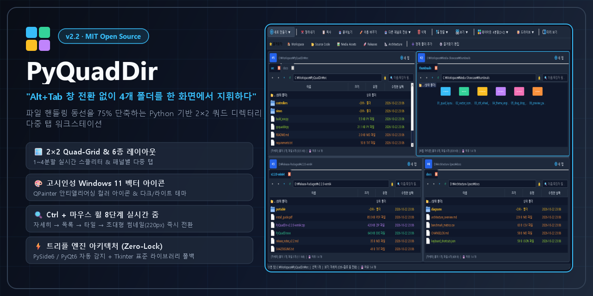
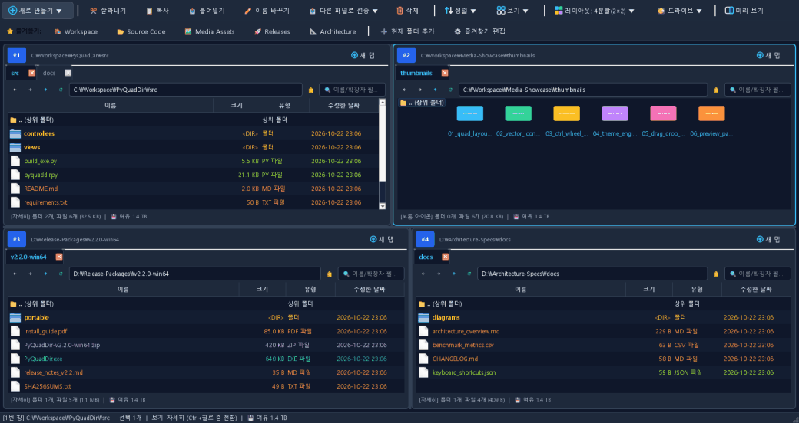
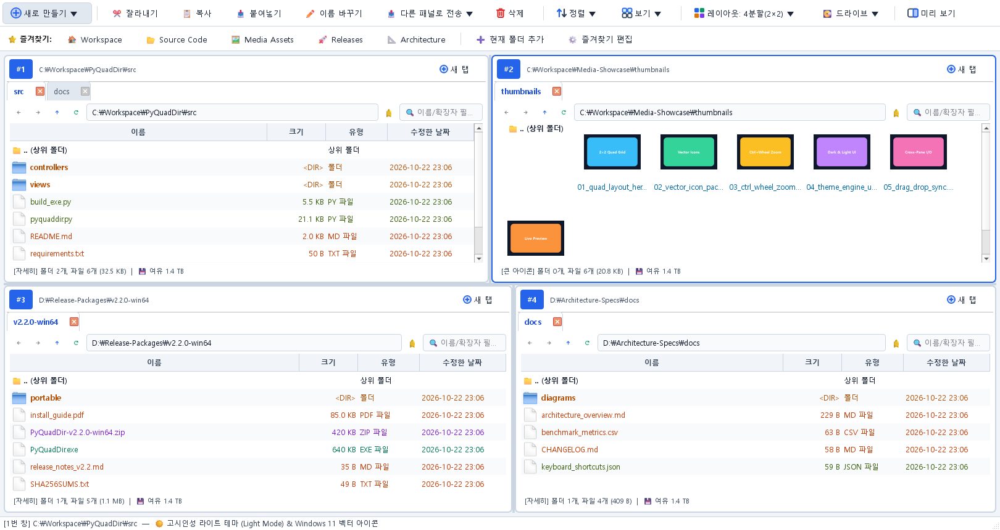
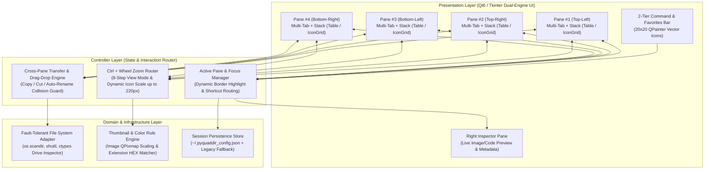

<div align="center">

<!-- Project Banner / Hero Image -->


# 🗂️ PyQuadDir

### *"Alt+Tab 창 전환 없이 4개 폴더를 한 화면에서 지휘하다"*
**4개 폴더와 여러 탭을 한 화면에서 다루는 데스크톱 파일 탐색기**

<p align="center">
  
  
  
  
  
</p>

<p align="center">
  <a href="#demo">📸 데모</a> •
  <a href="#features">✨ 핵심 기능</a> •
  <a href="#quick-start">🚀 빠른 시작</a> •
  <a href="#shortcuts">⌨️ 단축키</a> •
  <a href="#architecture">🏗️ 아키텍처</a>
</p>

</div>

---

## Windows에서 바로 시작

### [⬇ Windows 64-bit용 PyQuadDir.exe 다운로드](https://github.com/shinjaehyun20/PyQuadDir/releases/latest/download/PyQuadDir.exe)

**Windows x64용입니다. Python 설치는 필요 없지만 Microsoft Visual C++ v14 x64 Runtime 14.44.35211.0 이상이 필요합니다.** [최신 릴리스와 변경 사항](https://github.com/shinjaehyun20/PyQuadDir/releases/latest) · [전체 변경 기록](CHANGELOG.md)

1. 필요한 경우 [Microsoft 공식 Visual C++ v14 x64 런타임](https://aka.ms/vc14/vc_redist.x64.exe)을 직접 설치한 뒤 위 링크에서 `PyQuadDir.exe`를 내려받습니다. GitHub의 **Source code (zip)**은 실행 파일이 아닌 개발용 소스입니다.
2. 쓰기 가능한 원하는 폴더에 저장하고 실행합니다. 앱 설치 프로그램은 없습니다. Microsoft 런타임 DLL/설치 프로그램은 포함하지 않으며 자동 설치하지 않습니다. 라이선스 고지는 릴리스의 `PyQuadDir-v3.2.0-Windows-x64.zip`, 대응 소스와 빌드 안내는 `PyQuadDir-v3.2.0-sources.zip`에 있습니다.
3. 네 패널에서 각각 폴더를 열고 `Ctrl+T`로 탭을 추가합니다. `Ctrl+1`은 4분할, `Ctrl+마우스 휠`은 보기 확대·축소입니다.

- **주요 기능:** 4분할·다중 탭, 패널 간 복사·이동, 이미지/문서 미리 보기, 다크·라이트 테마, 세션 복원.
- **로컬 설정:** 홈 폴더의 `.pyquaddir_config.json`과 실행 폴더의 `.pyquaddir_session.json`에 방문 경로·탭·창 상태가 저장될 수 있습니다. 실행 파일을 다른 사람에게 전달할 때 개인 설정 파일을 함께 보내지 마세요.
- **Windows 보안 알림:** 서명되지 않은 실행 파일은 SmartScreen 경고가 표시될 수 있습니다. 경고만으로 안전성이나 위험성이 확정되지는 않습니다. 출처와 릴리스의 해시를 확인하고, 신뢰 여부를 판단할 수 없다면 실행하지 마세요. 보안 기능을 끌 필요는 없습니다.
- **해시 확인(선택):** PowerShell에서 `Get-FileHash .\PyQuadDir.exe -Algorithm SHA256`을 실행하여 릴리스에 제공된 SHA-256과 비교합니다.

**English:** A four-pane, multi-tab desktop file explorer. [Download the latest Windows executable](https://github.com/shinjaehyun20/PyQuadDir/releases/latest/download/PyQuadDir.exe); no Python installation required. Windows x64 requires Microsoft Visual C++ v14 x64 Runtime 14.44.35211.0 or newer, installed directly from Microsoft. Source users can follow Quick Start below.

### v3.2.0 수정 사항

여러 파일을 선택한 뒤 드래그하면 전체 선택이 유지되며, 주소창에 경로를 입력하고 Enter를 눌러도 부모 폴더로 튕기지 않습니다. 파일 경로를 입력하면 해당 폴더로 이동해 파일을 선택합니다.

Qt 엔진의 **도구** 메뉴에 일괄 이름 바꾸기·실행 취소, 패널 비교·선택 복사, 폴더 용량, 해시·중복 찾기, 목록 내보내기, 하위 파일 모아보기, 탭 복제·잠금, 빠른 이동을 추가했습니다. 자세한 변경은 [CHANGELOG](CHANGELOG.md)를 참고하세요.

**[v3.2.0 릴리스](https://github.com/shinjaehyun20/PyQuadDir/releases/tag/v3.2.0):** 실행 파일·라이선스 고지 ZIP·대응 소스 ZIP·`SHA256SUMS.txt`를 함께 제공합니다. [릴리스 노트](docs/releases/v3.2.0.md)에서 변경 사항과 파일 구성을 확인하세요. 소스 커밋·푸시와 릴리스 발행은 별도로 확인합니다.

- Qt 엔진에서 전체 도구를 제공합니다. Tkinter의 도구 메뉴는 폴더 용량·해시·CSV 내보내기만 제공합니다.
- 새 부가기능의 이름 변경·선택 복사·내보내기는 경로 보호를 구현한 Windows에서 지원합니다. macOS/Linux에서는 이 쓰기 작업을 거부하며 읽기·비교·해시 기능은 사용할 수 있습니다.
- 재귀 비교·용량·해시·중복 찾기는 현재 창에서 실행되므로 대형 폴더나 네트워크 드라이브에서는 응답이 늦어질 수 있습니다.

<a id="demo"></a>

## 📸 0. Live Demo

> **4개의 독립 디렉터리 뷰포트(Viewport) + 다중 탭 + `Ctrl + 마우스 휠` 8단계 실시간 줌 + 우측 실시간 미리 보기**를 단일 워크스페이스에서 제어합니다.

<div align="center">
  
  <p><i>▲ 4분할(2×2) 다중 탭 탐색, Ctrl+마우스 휠 썸네일 줌(148px~220px), 우측 실시간 미리 보기 및 다크/라이트 테마 전환 시연</i></p>
</div>

<details>
<summary><b>🖼️ 고해상도 다크 / 라이트 테마 스크린샷 펼쳐보기 (Click to Expand)</b></summary>
<br>

| 🌙 다크 테마 (Dark Theme — Default) | ☀️ 라이트 테마 (Light Theme) |
| :---: | :---: |
|  |  |

</details>

---

## 💡 1. Problem & Solution

### ❓ 왜 또 다른 파일 탐색기가 필요했는가?

데이터 엔지니어링, 소프트웨어 개발, 대규모 프로젝트 산출물 정리 과정에서 수많은 디렉터리를 동시에 다루어야 합니다. 그러나 기본 OS 탐색기 환경은 다음과 같은 고질적인 병목을 유발합니다:

1. **Window Juggling (창 겹침 현상)**: 원본(`Source`) 폴더 2개와 대상(`Destination`) 폴더 2개를 띄워놓고 작업할 때, 창이 서로 가려져 끊임없이 `Alt + Tab`을 반복해야 합니다.
2. **Dual-Pane의 한계**: 기존 2분할(Dual-Pane) 탐색기는 *'참고 자료 확인 + 소스코드 탐색 + 빌드 산출물 검증 + 백업 폴더 이동'* 등 **3개 이상의 경로가 얽힌 복합 워크플로우**를 한 화면에 수용하지 못합니다.
3. **시인성 및 마우스 동선 피로도**: 해상도가 높은 모니터에서 작은 유니코드 기호나 여러 단계를 거쳐야 하는 보기 메뉴는 반복 탐색 피로도를 가중시킵니다.

### ✅ PyQuadDir의 해법: *"Zero-Overlap 2×2 Quad-Grid & Instant Zoom"*

**PyQuadDir**는 클래식 윈도우 유틸리티 *Q-Dir*의 4분할 철학을 현대적인 Python(`PyQt6` + `Tkinter` 두 엔진) 아키텍처로 재해석한 오픈소스 프로젝트입니다.

| 비교 항목 | 기본 OS 파일 탐색기 | 일반 2분할 탐색기 | **PyQuadDir** |
| :--- | :---: | :---: | :---: |
| **동시 가시 경로 수** | 1개 (다중 창 수동 배열 필요) | 최대 2개 | **4개 패널 × 무제한 다중 탭 (2×2 Grid)** |
| **패널 간 파일 이동 동선** | 창 전환(`Alt+Tab`) 후 붙여넣기 | 좌↔우 단일 전송 | **상·하·좌·우 4방향 크로스 드래그 & 드롭 / 즉시 전송** |
| **아이콘/썸네일 크기 전환** | 상단 메뉴 2~3단계 클릭 | 별도 설정 메뉴 진입 | **`Ctrl + 마우스 휠` 8단계 실시간 줌 (최대 220px)** |
| **툴바 아이콘 시인성** | OS 종속 | 텍스트/소형 기호 위주 | **Windows 11 스타일 `QPainter` 안티앨리어싱 컬러 벡터 아이콘** |
| **런타임 의존성 안전망** | OS 내장 | 특정 프레임워크 강제 | **PyQt6 자동 감지 + Tkinter 대체 실행** |

---

<a id="features"></a>

## ✨ 2. Key Features

| 카테고리 | 주요 기능명 | 기술적 구현 및 사용자 가치 |
| :--- | :--- | :--- |
| **🧰 Power Tools (v3.2)** | **이름 변경·비교·검증·내보내기** | 여러 파일의 이름을 미리 보고 바꾸기, 패널 간 차이 비교와 선택 복사, 폴더 용량·해시·중복 확인, CSV·Markdown·HTML·TXT 내보내기 |
| **🪟 Layout & Tabs (v2.5)** | **6종 화면 분할 & 상·하단 50:50 동기화** | • **2×2 4분할(`Ctrl+1`)** 선택 시 위(`#1`·`#2`)·아래(`#3`·`#4`) 패널 너비 **50:50 정밀 일치 및 상·하단 중앙 구분선 실시간 연동**<br>• 긴 경로/파일명 진입 시에도 창 크기가 절대 튀지 않는 **`ElidedLabel` & `QSizePolicy.Ignored`** 레이아웃 잠금 |
| **🎨 Vector UI (v2.2)** | **고시인성 컬러 벡터 아이콘** | • 작은 텍스트 기호 대신 `QPainter` 안티앨리어싱으로 직접 렌더링한 **20×20px Windows 11 스타일 컬러 벡터 아이콘** 적용<br>• 다크 모드(`#0F172A`) / 라이트 모드(`#F1F5F9`) 원클릭 전환 및 확장자별 자동 색상 하이라이트 필터 |
| **🔍 View & Zoom (v2.2)** | **`Ctrl + 마우스 휠` 8단계 실시간 줌** | • 패널 위에서 `Ctrl + 마우스 휠` 스크롤만으로 **자세히 → 목록 → 콘텐츠 → 타일 → 작은 아이콘(48px) → 보통 아이콘(76px) → 큰 아이콘(108px) → 아주 큰 아이콘(148px~220px)** 연속 확대/축소<br>• 이미지 파일(`.png`, `.jpg`, `.webp`, `.bmp`, `.gif` 등) 실시간 비동기 썸네일 프리뷰 |
| **🖼️ Inspector & Viewer (v2.4)** | **내장 Excel/HTML 만능 뷰어 & 세부 정보** | • **내장 만능 뷰어(`🌐 내장 만능 뷰어로 보기`)**: 외부 프로그램 없이 `.xlsx` 엑셀 시트 표, `.html` 웹 렌더링 화면, `.md`/`.txt` 문서, 파일 헤더(HEX)를 앱 내부에서 즉시 열람<br>• **우측 미리 보기 / 세부 정보 창**: 이미지 리사이즈 뷰어, 픽셀 해상도(`W × H px`), 타임스탬프 실시간 표시 |
| **🛡️ Cloud & File Diagnostics (v2.4)** | **가상 드라이브(G:) 호환 & 매직 헤더 진단** | • **`safe_norm_path` 엔진**: Google Drive(`G:`) 등 가상 드라이브에서 `Path.resolve()`로 인한 `\\?\` 디바이스 경로 왜곡 및 삭제 차단(`WinError 387`) 원천 해결<br>• **`diagnose_file_health`**: 실행 전 파일 매직 바이트(`%PDF-`, `PK`, `OLE2`)를 검사하여 클라우드 미동기화(0B), 확장자 불일치(`.xls`/`.html` → `.xlsx`), DRM 암호화 여부를 즉시 진단 및 **로컬 캐시(`C:`) 우회 실행** 지원 |
| **⌨️ Navigation (v2.4)** | **키보드 고속 제어 & `file:///` 주소창 해독** | • **`Enter` / `Backspace`**: 선택 폴더 즉시 진입·파일 실행 및 상위 폴더 이동<br>• 브라우저에서 복사한 `file:///...` 및 `%20`/한글 퍼센트 인코딩 주소를 주소창에 붙여넣으면 자동 디코딩 후 해당 파일/폴더로 즉시 이동 |
| **💾 Persistence (v2.5)** | **실시간 세션 자동 복원 & 2층 즐겨찾기 바** | • 폴더 이동·탭 전환·종료(`closeEvent` & `atexit`) 시점마다 **4개 패널의 열린 탭 경로, 활성 탭 번호, 보기 모드, 창 크기**를 홈(`~/.pyquaddir_config.json`)과 실행 폴더(`.pyquaddir_session.json`)에 실시간 이중 저장 및 **재실행 시 복원** (`resolve_restorable_dir` 상위 폴더 자동 탐색 포함) |

---

<a id="architecture"></a>

## 🏗️ 3. System Architecture & Engineering Highlights

PyQuadDir는 단일 실행 스크립트(`pyquaddir.py`)의 배포 편의성을 유지하면서도, 내부적으로는 **UI 렌더링(Presentation) — 상태/이벤트 제어(Controller) — 파일시스템 I/O(Domain)** 계층을 엄격히 분리하여 설계되었습니다.



### 🔥 Technical Challenges & Solutions

#### 1. 4개 패널 동시 렌더링 시 포커스 충돌 및 상태 동기화 (Multi-Pane State Sync)
* **Problem**: 4개의 독립 패널(각각 다중 탭 보유)이 한 화면에 떠 있을 때, 단축키(`Enter`, `Backspace`, `Ctrl+C/V`, `Delete`, `F2`) 입력 시 어느 패널이 대상인지 모호해지거나, 패널 A에서 패널 B(동일 경로 열람 중)로 파일을 이동했을 때 UI가 갱신되지 않는 문제가 발생합니다.
* **Solution**:
  * `ExplorerPane.paneActivated` 시그널과 `QFrame#ExplorerPane[activePane="true"]` 동적 QSS 프로퍼티를 결합한 **Active Pane Focus Manager**를 구현하여, 클릭/포커스 즉시 `#38BDF8` 하이라이트 테두리와 상단 배지(`#1`~`#4`)를 갱신하고 모든 전역 단축키를 활성 탭으로 정확히 라우팅했습니다.
  * 파일 생성·복사·이동·삭제 트랜잭션 완료 시 `refresh_all_panes()` 브로드캐스트를 수행하여 4개 패널의 상태를 지연 없이 동기화합니다.

#### 2. `Ctrl + 마우스 휠` 연속 줌 전환 및 테이블 ↔ 아이콘 그리드 하이브리드 뷰 (v2.2)
* **Problem**: 상세 메타데이터 확인에는 테이블 뷰(`QTableWidget`)가 유리하고, 미디어/디자인 에셋 탐색에는 썸네일 그리드 뷰(`QListWidget.IconMode`)가 유리합니다. 두 위젯이 분리되어 있을 때 `Ctrl + 마우스 휠`로 끊김 없는 줌 경험을 제공하기 까다로웠습니다.
* **Solution**:
  * `QStackedWidget` 내부에 `FileTableView`와 `FileIconListView`를 결합하고, 두 뷰 모두에서 `wheelEvent`의 `ControlModifier`를 인터셉트하여 `DirectoryTab.step_wheel_zoom(steps)`으로 위임했습니다.
  * `ZOOM_WHEEL_ORDER`(`details` → `list` → `content` → `tiles` → `small_icons` → `medium_icons` → `large_icons` → `extra_large_icons`) 파이프라인을 통해 리스트 뷰에서 썸네일 그리드로 자동 전환되며, 최고 단계(`extra_large_icons`)에서 휠을 더 올리면 아이콘 해상도를 **148px에서 최대 220px까지 실시간 스케일업**하도록 구현했습니다.

#### 3. 파일 시스템 I/O 예외 격리 및 이름 충돌 자동 방어 (Fault-Tolerant File I/O)
* **Problem**: Windows 시스템 보호 폴더(`System Volume Information` 등) 접근 시 `PermissionError`로 인해 탐색기 전체가 멈추거나, 동일 폴더 내 복사/붙여넣기 시 덮어쓰기 사고가 발생할 위험이 있습니다.
* **Solution**:
  * 디렉터리 스캔(`os.scandir`) 및 메타데이터 조회 시 권한 예외를 개별 엔트리 단위로 격리하고 사용자 친화적인 상태 표시줄 알림으로 전환하여 **Zero-Crash 안정성**을 확보했습니다.
  * `get_unique_target_path()` 알고리즘을 통해 이름 충돌 시 `파일명 (1).ext`, `파일명 (2).ext` 형태로 자동 넘버링하여 원본 데이터 유실을 원천 차단합니다.

---

<a id="quick-start"></a>

## 🚀 4. Quick Start

### 방법 A. 단일 실행 파일 (`.exe`) — *Windows x64 권장*
Python이 설치되어 있지 않은 환경이라면 [**Releases 페이지**](../../releases)에서 최신 `PyQuadDir.exe`를 다운로드하고, 위의 Microsoft 런타임 요구 사항을 확인한 후 실행합니다.

### 방법 B. Python 소스코드로 직접 실행
```bash
# 1. 저장소 클론
git clone https://github.com/shinjaehyun20/PyQuadDir.git
cd PyQuadDir

# 2. (권장) 고해상도 Qt 엔진 설치
pip install -r requirements.txt

# 3. PyQuadDir 실행
python pyquaddir.py
```

전체 저장소를 함께 받아 실행하세요. `pyquaddir.py`는 `archive_safe_core.py`와 `pyquaddir_addons.py`를 사용합니다. Windows 소스·빌드는 Python 3.11에서 검증합니다.

<details>
<summary><b>⚙️ 실행 엔진 선택 옵션 및 단일 `.exe` 직접 빌드 방법</b></summary>
<br>

```bash
# PyQt6 엔진 우선 강제 실행
python pyquaddir.py --engine qt

# 외부 패키지 없이 Python 표준 내장 Tkinter 엔진으로 즉시 실행
python pyquaddir.py --engine tk

# 공개 배포와 같은 MSVC 비포함 빌드 (검증된 Windows/PyQt6 버전 필요)
python build_exe.py --system-msvc-runtime --no-open
```
</details>

---

### 설정을 보존하며 테스트하기

테스트에는 별도 프로필과 테스트 파일을 사용합니다. `--profile-dir`을 지정하면 사용자 홈과 실행 파일 옆 설정을 읽거나 덮어쓰지 않습니다.

```powershell
python pyquaddir.py --profile-dir .\test-profile
python -m unittest discover -s tests -v
python pyquaddir.py --self-test-gui --profile-dir .\test-profile
```

### 릴리스 관리

이 저장소에서 릴리스를 게시한 뒤에는 커밋·푸시할 때마다 소스 버전과 최신 릴리스·태그·다운로드 파일의 일치 여부도 확인합니다. 새 버전의 배포 대상 변경이면 검증한 실행 파일, 릴리스 노트, 해시와 대응 소스를 함께 갱신합니다. 문서만 수정한 경우에는 실행 파일을 다시 올릴 필요가 없습니다. 자세한 절차는 [릴리스 관리 안내](docs/RELEASING.md)를 따릅니다.

<a id="shortcuts"></a>

## ⌨️ 5. Keyboard Shortcuts

<details open>
<summary><b>단축키 일람표 (클릭하여 접기/펼치기)</b></summary>
<br>

| 단축키 / 조작 | 동작 설명 |
| :--- | :--- |
| **`Ctrl + 마우스 휠 위/아래`** | **현재 패널 보기 모드 8단계 연속 확대/축소** (자세히 ↔ 목록 ↔ 타일 ↔ 최대 220px 썸네일) |
| **`Enter` / `더블클릭`** | 선택한 폴더 안으로 즉시 진입 / 선택한 파일을 OS 기본 프로그램으로 실행 |
| **`Backspace` / `Alt + ↑`** | 상위 폴더(`..`)로 이동 |
| **`Alt + ←` / `Alt + →`** | 현재 탭의 이전 경로(Back) / 다음 경로(Forward) 히스토리 이동 |
| **`Ctrl + 1` ~ `Ctrl + 6`** | 화면 분할 레이아웃 즉시 전환 (`1`: 4분할, `2`: 좌우, `3`: 상하, `4`: 좌1·우2, `5`: 상1·하2, `6`: 단일) |
| **`Ctrl + T` / `Ctrl + W`** | 현재 활성 패널에 새 폴더 탭 열기 / 현재 탭 닫기 (마우스 가운데 휠 클릭으로도 닫기 가능) |
| **`Ctrl + C` / `Ctrl + X` / `Ctrl + V`** | 선택 항목 복사 / 잘라내기 / 현재 활성 패널에 붙여넣기 (동일 이름 자동 넘버링 보존) |
| **`F2`** | 선택 항목 이름 바꾸기 |
| **`Delete`** | 선택 항목 삭제 (삭제 전 확인 대화상자 표시) |
| **`Ctrl + Shift + N`** | 현재 활성 폴더에 새 폴더 생성 |
| **`F5`** | 4개 패널 전체 새로고침 |
| **`Ctrl + M` / `Ctrl + Shift + Z`** | 일괄 이름 바꾸기 / 마지막 일괄 변경 실행 취소 |
| **`Shift + F2`** | 패널 비교 및 선택 복사 |
| **`Alt + Shift + Enter`** | 폴더 용량 계산 |
| **`Ctrl + Shift + H`** | 파일 해시 검증 및 중복 파일 찾기 |
| **`Ctrl + Shift + E`** | CSV·Markdown·HTML·TXT 목록 내보내기 |
| **`Ctrl + B`** | 하위 파일 모아보기 전환 |
| **`Ctrl + Shift + K` / `Ctrl + Shift + L`** | 탭 복제 / 탭 잠금 전환 |
| **`Ctrl + P`** | 경로·즐겨찾기·명령 빠른 이동 |

</details>

---

## 🗺️ 6. Product Roadmap

- [x] **v1.0**: 2×2 4분할 가변 스플리터, 패널별 다중 탭, 드래그 앤 드롭, 확장자별 색상 필터, 다크/라이트 테마
- [x] **v2.0**: Windows 11 스타일 2층 명령 바 & 즐겨찾기 바 분리, 8종 보기 모드, 6종 정렬·4종 그룹화, 우측 미리 보기/세부 정보 창
- [x] **v2.2**:
  - [x] `QPainter` 기반 20×20px 고시인성 Windows 11 컬러 벡터 아이콘 엔진 (`create_ui_icon`)
  - [x] `Ctrl + 마우스 휠` 실시간 보기 모드 전환 및 최대 220px 연속 썸네일 줌
  - [x] 테이블 뷰 & 아이콘 그리드 뷰 `Enter`/`Return` 폴더 진입·파일 실행 및 `Backspace` 상위 이동 완비
- [x] **v2.4**:
  - [x] Google Drive(`G:`) 등 가상 드라이브 경로 왜곡(`Path.resolve()`) 전면 제거 및 로컬 캐시(`C:`) 우회 실행 엔진
  - [x] 실행 전 파일 매직 헤더(`%PDF-`, `PK`, `OLE2`, 기업 DRM) & 클라우드 스트리밍(0바이트) 정밀 진단기 (`diagnose_file_health`)
  - [x] 외부 프로그램 없이 동작하는 **내장 Excel(`.xlsx`) 시트 표 뷰어 & HTML 렌더링 만능 뷰어** 탑재
  - [x] 주소창 `file:///` 프로토콜 및 URL 퍼센트 인코딩(`%20`, 한글) 자동 해독 & 파일 경로 직접 포커싱
- [x] **v2.5**:
  - [x] 종료 전 열어둔 4개 패널 디렉터리·활성 탭·보기 모드·창 크기 실시간 이중 저장 및 재실행 시 복원 (`resolve_restorable_dir`)
  - [x] 긴 경로/파일명 진입 시 창·패널 크기 튐(Jumping) 원천 차단 (`ElidedLabel` & `QSizePolicy.Ignored`)
  - [x] 4분할(`quad`) 선택 시 위·아래 패널 너비 50:50 정밀 통일 및 상·하단 중앙 구분선 실시간 동기화
- [x] **v3.2.0**: 다중 파일 이동·주소창 Enter 수정, 일괄 이름 변경, 패널 비교, 폴더 용량·해시·중복 찾기, 목록 내보내기 및 탐색 도구

---

## 📄 7. License & Contact

이 저장소의 자체 소스코드는 **MIT License**입니다. 자세한 내용은 [`LICENSE`](LICENSE)를 참고하세요. 실행 파일에 포함된 Qt/Python 등 제3자 구성 요소에는 각각의 별도 라이선스가 적용되며, 바이너리 배포 시 해당 고지와 소스 제공 의무를 별도로 확인해야 합니다.

* **GitHub**: [@shinjaehyun20](https://github.com/shinjaehyun20)
* **Issue & Feature Request**: [GitHub Issues](../../issues)

---
<div align="center">
  <sub>Built with ❤️ using Python. If this project saved your time, please consider giving it a ⭐!</sub>
</div>
