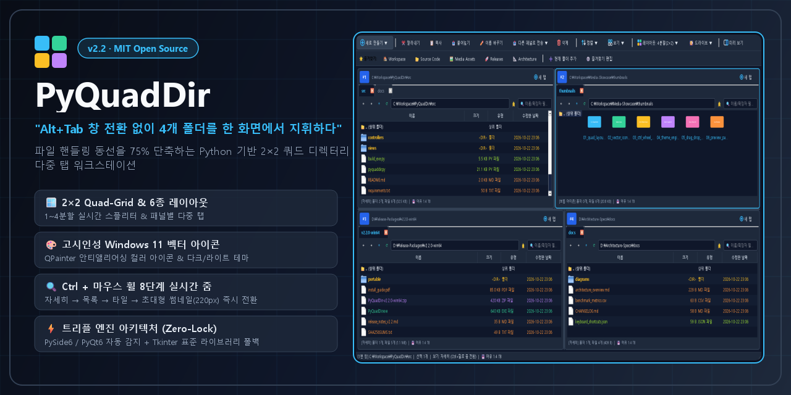
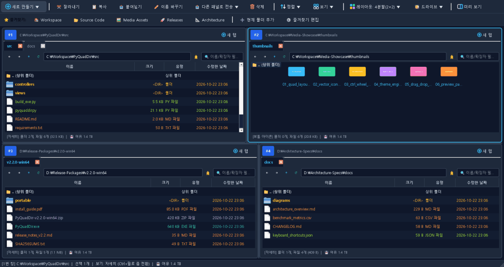
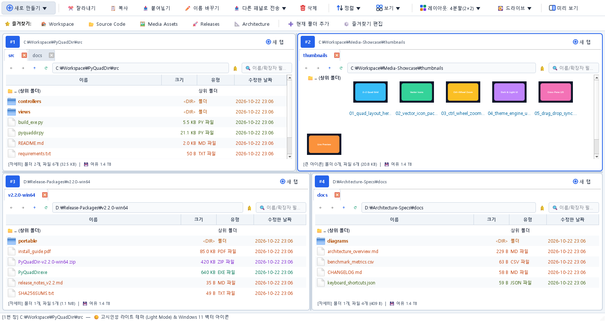
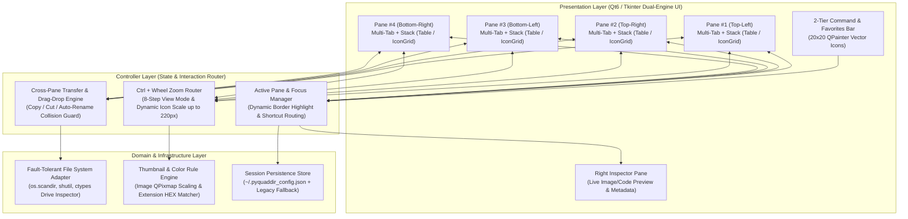

<div align="center">

<!-- Project Banner / Hero Image -->


# 🗂️ PyQuadDir

### *"Alt+Tab 창 전환 없이 4개 폴더를 한 화면에서 지휘하다"*
**파일 핸들링 동선을 75% 단축하는 Python 기반 2×2 쿼드 디렉터리 다중 탭 워크스테이션**

<p align="center">
  
  
  
  
  
</p>

<p align="center">
  <a href="#-0-live-demo">📸 라이브 데모</a> •
  <a href="#-1-problem--solution">💡 기획 배경</a> •
  <a href="#-2-key-features">✨ 핵심 기능</a> •
  <a href="#️-3-system-architecture--engineering-highlights">🏗️ 아키텍처 & 기술 챌린지</a> •
  <a href="#-4-quick-start">🚀 빠른 시작</a> •
  <a href="#️-5-keyboard-shortcuts">⌨️ 단축키</a>
</p>

</div>

---

## 📸 0. Live Demo

> **4개의 독립 디렉터리 뷰포트(Viewport) + 다중 탭 + `Ctrl + 마우스 휠` 8단계 실시간 줌 + 우측 실시간 미리 보기**를 단일 워크스페이스에서 제어합니다.

<div align="center">
  
  <p><i>▲ 4분할(2×2) 다중 탭 탐색, Ctrl+마우스 휠 썸네일 줌(148px~220px), 우측 실시간 미리 보기 및 다크/라이트 테마 전환 시연</i></p>
</div>

<details>
<summary><b>🖼️ 고해상도 다크 / 라이트 테마 스크린샷 펼쳐보기 (Click to Expand)</b></summary>
<br>

| 🌙 다크 테마 (Dark Theme — Default) | ☀️ 라이트 테마 (Light Theme) |
| :---: | :---: |
|  |  |

</details>

---

## 💡 1. Problem & Solution

### ❓ 왜 또 다른 파일 탐색기가 필요했는가?

데이터 엔지니어링, 소프트웨어 개발, 대규모 프로젝트 산출물 정리 과정에서 수많은 디렉터리를 동시에 다루어야 합니다. 그러나 기본 OS 탐색기 환경은 다음과 같은 고질적인 병목을 유발합니다:

1. **Window Juggling (창 겹침 현상)**: 원본(`Source`) 폴더 2개와 대상(`Destination`) 폴더 2개를 띄워놓고 작업할 때, 창이 서로 가려져 끊임없이 `Alt + Tab`을 반복해야 합니다.
2. **Dual-Pane의 한계**: 기존 2분할(Dual-Pane) 탐색기는 *'참고 자료 확인 + 소스코드 탐색 + 빌드 산출물 검증 + 백업 폴더 이동'* 등 **3개 이상의 경로가 얽힌 복합 워크플로우**를 한 화면에 수용하지 못합니다.
3. **시인성 및 마우스 동선 피로도**: 해상도가 높은 모니터에서 작은 유니코드 기호나 여러 단계를 거쳐야 하는 보기 메뉴는 반복 탐색 피로도를 가중시킵니다.

### ✅ PyQuadDir의 해법: *"Zero-Overlap 2×2 Quad-Grid & Instant Zoom"*

**PyQuadDir**는 클래식 윈도우 유틸리티 *Q-Dir*의 4분할 철학을 현대적인 Python(`PySide6`/`PyQt6` + `Tkinter` 트리플 엔진) 아키텍처로 재해석한 오픈소스 프로젝트입니다.

| 비교 항목 | 기본 OS 파일 탐색기 | 일반 2분할 탐색기 | **PyQuadDir (v2.2)** |
| :--- | :---: | :---: | :---: |
| **동시 가시 경로 수** | 1개 (다중 창 수동 배열 필요) | 최대 2개 | **4개 패널 × 무제한 다중 탭 (2×2 Grid)** |
| **패널 간 파일 이동 동선** | 창 전환(`Alt+Tab`) 후 붙여넣기 | 좌↔우 단일 전송 | **상·하·좌·우 4방향 크로스 드래그 & 드롭 / 즉시 전송** |
| **아이콘/썸네일 크기 전환** | 상단 메뉴 2~3단계 클릭 | 별도 설정 메뉴 진입 | **`Ctrl + 마우스 휠` 8단계 실시간 줌 (최대 220px)** |
| **툴바 아이콘 시인성** | OS 종속 | 텍스트/소형 기호 위주 | **Windows 11 스타일 `QPainter` 안티앨리어싱 컬러 벡터 아이콘** |
| **런타임 의존성 안전망** | OS 내장 | 특정 프레임워크 강제 | **PySide6 / PyQt6 자동 감지 + Tkinter 무설치 폴백** |

---

## ✨ 2. Key Features

| 카테고리 | 주요 기능명 | 기술적 구현 및 사용자 가치 |
| :--- | :--- | :--- |
| **🪟 Layout & Tabs** | **6종 화면 분할 & 다중 탭** | • **2×2 4분할(`Ctrl+1`)**, 좌/우 2분할(`Ctrl+2`), 상/하 2분할(`Ctrl+3`), 3분할(`Ctrl+4`/`5`), 단일 최대화(`Ctrl+6`) 즉시 전환<br>• 패널별 브라우저 스타일 다중 탭(`Ctrl+T`, `Ctrl+W`, 마우스 휠 클릭 닫기) 및 스플리터 비율 균등 정렬 |
| **🎨 Vector UI (v2.2)** | **고시인성 컬러 벡터 아이콘** | • 작은 텍스트 기호 대신 `QPainter` 안티앨리어싱으로 직접 렌더링한 **20×20px Windows 11 스타일 컬러 벡터 아이콘** 적용<br>• 다크 모드(`#0F172A`) / 라이트 모드(`#F1F5F9`) 원클릭 전환 및 확장자별 자동 색상 하이라이트 필터 |
| **🔍 View & Zoom (v2.2)** | **`Ctrl + 마우스 휠` 8단계 실시간 줌** | • 패널 위에서 `Ctrl + 마우스 휠` 스크롤만으로 **자세히 → 목록 → 콘텐츠 → 타일 → 작은 아이콘(48px) → 보통 아이콘(76px) → 큰 아이콘(108px) → 아주 큰 아이콘(148px~220px)** 연속 확대/축소<br>• 이미지 파일(`.png`, `.jpg`, `.webp`, `.bmp`, `.gif` 등) 실시간 비동기 썸네일 프리뷰 |
| **🖼️ Inspector & Viewer (v2.4)** | **내장 Excel/HTML 만능 뷰어 & 세부 정보** | • **내장 만능 뷰어(`🌐 내장 만능 뷰어로 보기`)**: 외부 프로그램 없이 `.xlsx` 엑셀 시트 표, `.html` 웹 렌더링 화면, `.md`/`.txt` 문서, 파일 헤더(HEX)를 앱 내부에서 즉시 열람<br>• **우측 미리 보기 / 세부 정보 창**: 이미지 리사이즈 뷰어, 픽셀 해상도(`W × H px`), 타임스탬프 실시간 표시 |
| **🛡️ Cloud & File Diagnostics (v2.4)** | **가상 드라이브(G:) 호환 & 매직 헤더 진단** | • **`safe_norm_path` 엔진**: Google Drive(`G:`) 등 가상 드라이브에서 `Path.resolve()`로 인한 `\\?\` 디바이스 경로 왜곡 및 삭제 차단(`WinError 387`) 원천 해결<br>• **`diagnose_file_health`**: 실행 전 파일 매직 바이트(`%PDF-`, `PK`, `OLE2`)를 검사하여 클라우드 미동기화(0B), 확장자 불일치(`.xls`/`.html` → `.xlsx`), DRM 암호화 여부를 즉시 진단 및 **로컬 캐시(`C:`) 우회 실행** 지원 |
| **⌨️ Navigation (v2.4)** | **키보드 고속 제어 & `file:///` 주소창 해독** | • **`Enter` / `Backspace`**: 선택 폴더 즉시 진입·파일 실행 및 상위 폴더 이동<br>• 브라우저에서 복사한 `file:///...` 및 `%20`/한글 퍼센트 인코딩 주소를 주소창에 붙여넣으면 자동 디코딩 후 해당 파일/폴더로 즉시 이동 |
| **💾 Persistence** | **2층 즐겨찾기 바 & 세션 보존** | • 상단 2층 전체 폭을 사용하는 **즐겨찾기 전용 바(⭐)** 및 드라이브 용량 게이지 드롭다운(`💽 드라이브 ▼`)<br>• 종료 시 열려 있던 4개 패널의 모든 탭 경로, 레이아웃, 테마, 색상 규칙을 `~/.pyquaddir_config.json`에 자동 보존 |

---

## 🏗️ 3. System Architecture & Engineering Highlights

PyQuadDir는 단일 실행 스크립트(`pyquaddir.py`)의 배포 편의성을 유지하면서도, 내부적으로는 **UI 렌더링(Presentation) — 상태/이벤트 제어(Controller) — 파일시스템 I/O(Domain)** 계층을 엄격히 분리하여 설계되었습니다.



### 🔥 Technical Challenges & Solutions

#### 1. 4개 패널 동시 렌더링 시 포커스 충돌 및 상태 동기화 (Multi-Pane State Sync)
* **Problem**: 4개의 독립 패널(각각 다중 탭 보유)이 한 화면에 떠 있을 때, 단축키(`Enter`, `Backspace`, `Ctrl+C/V`, `Delete`, `F2`) 입력 시 어느 패널이 대상인지 모호해지거나, 패널 A에서 패널 B(동일 경로 열람 중)로 파일을 이동했을 때 UI가 갱신되지 않는 문제가 발생합니다.
* **Solution**:
  * `ExplorerPane.paneActivated` 시그널과 `QFrame#ExplorerPane[activePane="true"]` 동적 QSS 프로퍼티를 결합한 **Active Pane Focus Manager**를 구현하여, 클릭/포커스 즉시 `#38BDF8` 하이라이트 테두리와 상단 배지(`#1`~`#4`)를 갱신하고 모든 전역 단축키를 활성 탭으로 정확히 라우팅했습니다.
  * 파일 생성·복사·이동·삭제 트랜잭션 완료 시 `refresh_all_panes()` 브로드캐스트를 수행하여 4개 패널의 상태를 지연 없이 동기화합니다.

#### 2. `Ctrl + 마우스 휠` 연속 줌 전환 및 테이블 ↔ 아이콘 그리드 하이브리드 뷰 (v2.2)
* **Problem**: 상세 메타데이터 확인에는 테이블 뷰(`QTableWidget`)가 유리하고, 미디어/디자인 에셋 탐색에는 썸네일 그리드 뷰(`QListWidget.IconMode`)가 유리합니다. 두 위젯이 분리되어 있을 때 `Ctrl + 마우스 휠`로 끊김 없는 줌 경험을 제공하기 까다로웠습니다.
* **Solution**:
  * `QStackedWidget` 내부에 `FileTableView`와 `FileIconListView`를 결합하고, 두 뷰 모두에서 `wheelEvent`의 `ControlModifier`를 인터셉트하여 `DirectoryTab.step_wheel_zoom(steps)`으로 위임했습니다.
  * `ZOOM_WHEEL_ORDER`(`details` → `list` → `content` → `tiles` → `small_icons` → `medium_icons` → `large_icons` → `extra_large_icons`) 파이프라인을 통해 리스트 뷰에서 썸네일 그리드로 자동 전환되며, 최고 단계(`extra_large_icons`)에서 휠을 더 올리면 아이콘 해상도를 **148px에서 최대 220px까지 실시간 스케일업**하도록 구현했습니다.

#### 3. 파일 시스템 I/O 예외 격리 및 이름 충돌 자동 방어 (Fault-Tolerant File I/O)
* **Problem**: Windows 시스템 보호 폴더(`System Volume Information` 등) 접근 시 `PermissionError`로 인해 탐색기 전체가 멈추거나, 동일 폴더 내 복사/붙여넣기 시 덮어쓰기 사고가 발생할 위험이 있습니다.
* **Solution**:
  * 디렉터리 스캔(`os.scandir`) 및 메타데이터 조회 시 권한 예외를 개별 엔트리 단위로 격리하고 사용자 친화적인 상태 표시줄 알림으로 전환하여 **Zero-Crash 안정성**을 확보했습니다.
  * `get_unique_target_path()` 알고리즘을 통해 이름 충돌 시 `파일명 (1).ext`, `파일명 (2).ext` 형태로 자동 넘버링하여 원본 데이터 유실을 원천 차단합니다.

---

## 🚀 4. Quick Start

### 방법 A. 무설치 포터블 실행 파일 (`.exe`) — *Windows 권장*
Python이 설치되어 있지 않은 환경이라면 [**Releases 페이지**](../../releases)에서 최신 `PyQuadDir.exe`를 다운로드하여 즉시 실행할 수 있습니다.

### 방법 B. Python 소스코드로 직접 실행
```bash
# 1. 저장소 클론
git clone https://github.com/shinjaehyun20/PyQuadDir.git
cd PyQuadDir

# 2. (권장) 고해상도 Qt 엔진 설치
pip install -r requirements.txt

# 3. PyQuadDir 실행
python pyquaddir.py
```

<details>
<summary><b>⚙️ 실행 엔진 선택 옵션 및 단일 `.exe` 직접 빌드 방법</b></summary>
<br>

```bash
# PyQt6 엔진 우선 강제 실행
python pyquaddir.py --pyqt6

# 외부 패키지 없이 Python 표준 내장 Tkinter 엔진으로 즉시 실행
python pyquaddir.py --tk

# PyInstaller 기반 무설치 단일 실행 파일(dist/PyQuadDir.exe) 직접 빌드
python build_exe.py
```
</details>

---

## ⌨️ 5. Keyboard Shortcuts

<details open>
<summary><b>단축키 일람표 (클릭하여 접기/펼치기)</b></summary>
<br>

| 단축키 / 조작 | 동작 설명 |
| :--- | :--- |
| **`Ctrl + 마우스 휠 위/아래`** | **현재 패널 보기 모드 8단계 연속 확대/축소** (자세히 ↔ 목록 ↔ 타일 ↔ 최대 220px 썸네일) |
| **`Enter` / `더블클릭`** | 선택한 폴더 안으로 즉시 진입 / 선택한 파일을 OS 기본 프로그램으로 실행 |
| **`Backspace` / `Alt + ↑`** | 상위 폴더(`..`)로 이동 |
| **`Alt + ←` / `Alt + →`** | 현재 탭의 이전 경로(Back) / 다음 경로(Forward) 히스토리 이동 |
| **`Ctrl + 1` ~ `Ctrl + 6`** | 화면 분할 레이아웃 즉시 전환 (`1`: 4분할, `2`: 좌우, `3`: 상하, `4`: 좌1·우2, `5`: 상1·하2, `6`: 단일) |
| **`Ctrl + T` / `Ctrl + W`** | 현재 활성 패널에 새 폴더 탭 열기 / 현재 탭 닫기 (마우스 가운데 휠 클릭으로도 닫기 가능) |
| **`Ctrl + C` / `Ctrl + X` / `Ctrl + V`** | 선택 항목 복사 / 잘라내기 / 현재 활성 패널에 붙여넣기 (동일 이름 자동 넘버링 보존) |
| **`F2`** | 선택 항목 이름 바꾸기 |
| **`Delete`** | 선택 항목 삭제 (삭제 전 확인 대화상자 표시) |
| **`Ctrl + Shift + N`** | 현재 활성 폴더에 새 폴더 생성 |
| **`F5`** | 4개 패널 전체 새로고침 |

</details>

---

## 🗺️ 6. Product Roadmap

- [x] **v1.0**: 2×2 4분할 가변 스플리터, 패널별 다중 탭, 드래그 앤 드롭, 확장자별 색상 필터, 다크/라이트 테마
- [x] **v2.0**: Windows 11 스타일 2층 명령 바 & 즐겨찾기 바 분리, 8종 보기 모드, 6종 정렬·4종 그룹화, 우측 미리 보기/세부 정보 창
- [x] **v2.2**:
  - [x] `QPainter` 기반 20×20px 고시인성 Windows 11 컬러 벡터 아이콘 엔진 (`create_ui_icon`)
  - [x] `Ctrl + 마우스 휠` 실시간 보기 모드 전환 및 최대 220px 연속 썸네일 줌
  - [x] 테이블 뷰 & 아이콘 그리드 뷰 `Enter`/`Return` 폴더 진입·파일 실행 및 `Backspace` 상위 이동 완비
- [x] **v2.4 (Current)**:
  - [x] Google Drive(`G:`) 등 가상 드라이브 경로 왜곡(`Path.resolve()`) 전면 제거 및 로컬 캐시(`C:`) 우회 실행 엔진
  - [x] 실행 전 파일 매직 헤더(`%PDF-`, `PK`, `OLE2`, 기업 DRM) & 클라우드 스트리밍(0바이트) 정밀 진단기 (`diagnose_file_health`)
  - [x] 외부 프로그램 없이 동작하는 **내장 Excel(`.xlsx`) 시트 표 뷰어 & HTML 렌더링 만능 뷰어** 탑재
  - [x] 주소창 `file:///` 프로토콜 및 URL 퍼센트 인코딩(`%20`, 한글) 자동 해독 & 파일 경로 직접 포커싱
- [ ] **v2.5 (Planned)**: 정규표현식(Regex) 기반 다중 파일 일괄 이름 변경(Batch Rename) 유틸리티 및 폴더 용량 트리 분석기

---

## 📄 7. License & Contact

이 프로젝트는 **MIT License** 하에 배포됩니다. 자세한 내용은 [`LICENSE`](LICENSE) 파일을 참고하세요.

* **GitHub**: [@shinjaehyun20](https://github.com/shinjaehyun20)
* **Issue & Feature Request**: [GitHub Issues](../../issues)

---
<div align="center">
  <sub>Built with ❤️ using Python. If this project saved your time, please consider giving it a ⭐!</sub>
</div>
